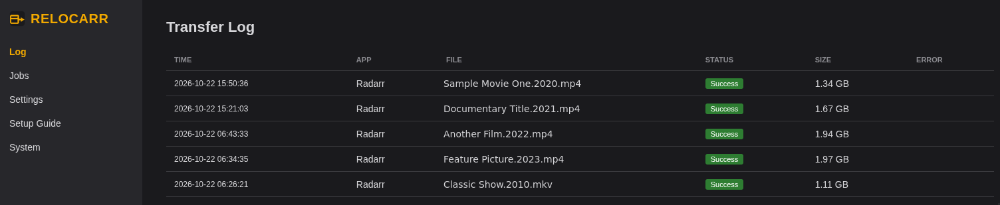
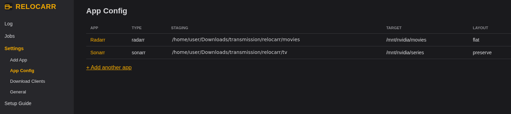
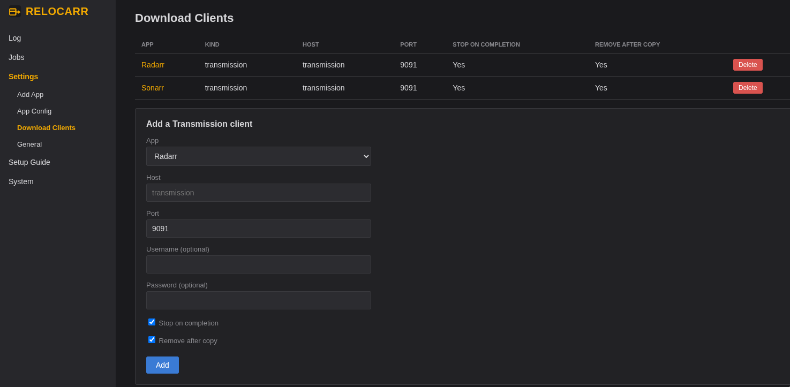
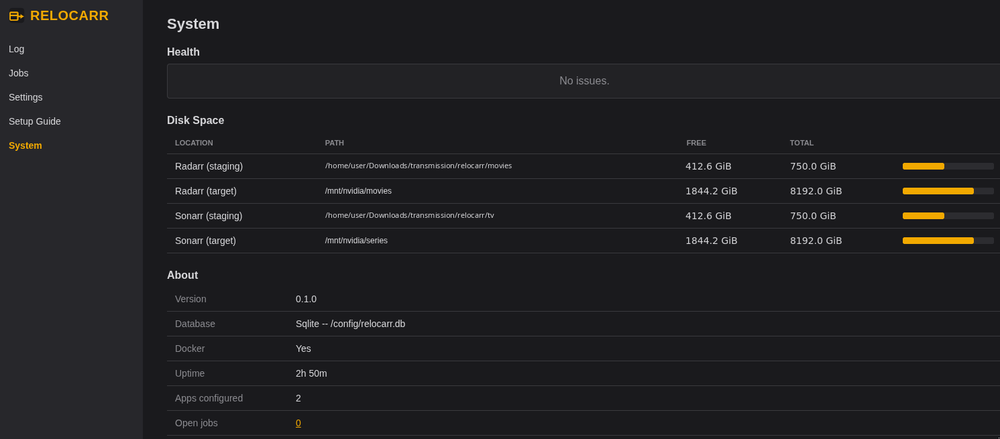

# relocarr
Connects Radarr, Sonarr, Transmission, Plex.
Radarr & Sonarr hand over the torrent file to Transmission.
Transmission performs the download.
Radarr / Sonarr perform the renaming. 

Relocarr End to End
1: controlls the transfer to NAS (i.e. Plex) - for movies flat folder structure and series following the series, episode folder structure
2: Cleans up finished downloads from Transmission (deletes finished torrent entries)
3: it can re-downloads a smaller version if you like to improve space on your disk
4: it can delete duplicates from your NAS

See [PLAN.md](PLAN.md) for the full design and the rationale behind it.


**Status: v1.3.0 — stable, running real production traffic since v0.1.0.** Every core piece
(webhook receiver, job state machine, removal gate, download-client watcher, scheduler, Preflight
page, Docker image) plus the Redownload, Queue, and Library-page tooling built since the initial
release (PLAN.md §19) is implemented, tested, and has handled real imports end to end — see
PLAN.md's "v0.1 implementation status" under §15 and the features added since under §19.

## Screenshots

| Log | App Config |
|---|---|
|  |  |

| Download Clients | System |
|---|---|
|  |  |

## Install

Requires Docker + the Docker Compose plugin.

```bash
git clone https://github.com/a000a999a/relocarr.git
cd relocarr
./install.sh
```

The script asks a few questions (your downloads/staging root, your media/target root, and
optionally the Docker network your Radarr/Sonarr/Transmission containers are already on), writes
them to `.env`, then builds and starts the container.

- **Re-run it any time** — with no flags it reuses your existing `.env`, rebuilds the image, and
  restarts the container without touching your configured apps or job history.
- `./install.sh --reconfigure` — change the paths, network, port, etc. (backs up the old `.env`
  first).
- `./install.sh --reset-db` — wipe all configured apps/jobs and start over from an empty database
  (backs up the old one first). Useful for a true "configure from scratch."

The two root paths **must be the same path your *arr apps themselves use** — relocarr has to see
each file at the exact path the *arr reports it at in the webhook payload. See `.env.example`
for the full list of settings.

## Configure

1. Open the web UI (the install script prints the URL, default `http://<this host>:8686/`) and
   add a Radarr or Sonarr instance through the setup wizard (Add App).
2. On its App Detail page, set the target folder, layout, and a Transmission download client.
3. Check its Preflight page — it audits the *arr's own settings for the things that would let
   two automations fight over the same files (see PLAN.md §10).
4. Add the Webhook connection it shows you to the *arr (Connect → Webhook).
5. Leave **dry run** on (Settings — it's on by default) and watch the logs for what it *would*
   do on a real import before turning it off.

See the in-app **Setup Guide** page for the full Radarr/Sonarr/Transmission checklist.

## Using it

### Jobs

One row per imported file, moving through: `IMPORTED` → `COPYING` → `VERIFIED` → `PUBLISHED` →
`RECONCILED` → `DONE` (see PLAN.md §5 for what each step actually does). A job stuck on a
transient failure retries itself with backoff; one that needs a human shows `NEEDS_ATTENTION`
with **Retry**, **Skip**, or **Abort & Delete**.

Three maintenance tools live on this page, each a safety net for something the automatic
pipeline can miss:

- **Find completed torrents still in Transmission** — a `DONE` job's torrent is normally removed
  automatically once every file sharing that download is reconciled (the removal gate, PLAN.md
  §5), but a stuck sibling or a missing download client can leave it sitting there. Lists every
  torrent that's both finished and backed by a `DONE` job, and mass-deletes the checked ones
  (through Transmission's own API, so it's stopped cleanly first).
- **Find transferred movies on source** — same idea, but for the file itself rather than the
  torrent entry: any `DONE` job whose source file is still physically sitting in staging. Still
  seeding in Transmission → removed through Transmission; otherwise deleted straight off disk.
- **Find & trigger missed transfers to target folder (i.e. your Plex library)** — the whole
  pipeline starts from Radarr's "Download" webhook;
  if that webhook never arrives (confirmed live, 2026-10-25 — a missed delivery during a relocarr
  restart left real imports sitting in staging with no job at all, never copied anywhere) nothing
  else would ever notice. Scans Radarr's own movie list directly for a file with no matching job
  and creates one — from there it's picked up by the normal pipeline like any other import.

### Log

Transfer history, a free-space projection, and a size summary of the movie library actually on
disk (not just relocarr's own job history, which only covers files it personally moved). Clicking
a size bucket lists every file in that range with its poster (from Plex, when configured — see
below), the date it landed (so you can tell a recent redownload from an old file at a glance),
and a **Redownload** action — per file or in bulk — that only ever grabs a release genuinely
smaller than the current one at the same quality (ranked by seeders, then resolution; see
`arr/radarr.py`'s `find_smaller_release`). Nothing downloads if nothing smaller turns up. Once a
smaller file lands, any older/larger file sharing the same title and year is removed
automatically.

### Plex integration

Optional — Settings → Plex, a base URL and an
[X-Plex-Token](https://support.plex.tv/articles/204059436-finding-an-authentication-token-x-plex-token/).
Once connected, Plex's own metadata (not relocarr's own filename-based guesses) drives three
things:

- **Posters and deep links.** The Library page's size-bucket file list and the duplicate-review
  page both show each file's real poster, pulled from Plex and proxied through relocarr's own
  server (so the Plex token never ends up in page source) — clicking it opens that movie's page
  in Plex Web. Without Plex configured, these slots show a "Plex integration needed" placeholder
  instead of silently falling back to a different poster source.
- **Real quality info.** Duplicate rows on `/log/duplicates` show the actual resolution/codec/
  bitrate Plex sees for each file, instead of relying on filename and size alone.
- **Duplicate grouping.** `/log/duplicates` groups by Plex's own `duplicate=1` library filter —
  the same source its own "Duplicates" view uses — rather than a (title, year) filename regex,
  which catches cases like two different naming conventions for the same release that a regex
  can miss or get wrong.

A background check (10-minute interval, same cadence as the library scan) keeps this cached —
never a live Plex call inside a page request — so a slow or unreachable Plex server can't hang
any page, only leave the cached data stale until the next cycle.

## Security

**The web UI has no login yet** (planned — see PLAN.md's Settings section). Anyone who can reach
port 8686 can see your Radarr/Sonarr API keys and Transmission credentials, change where files
are moved, and trigger Redownloads. So:

- Keep it on your LAN only. **Never forward port 8686 on your router** or expose it to the
  internet. If you need remote access, put it behind a VPN or a reverse proxy that adds its own
  authentication.

Forms in the UI are protected against cross-site request forgery: a state-changing request
whose `Origin`/`Referer` is another site is rejected, so a random web page you open can't
silently change relocarr's settings through your browser. The webhook endpoint is separately
authenticated by its per-app `X-Relocarr-Token` header.

## Development

```bash
python3 -m venv .venv
. .venv/bin/activate
pip install -e ".[dev]"
pytest
RELOCARR_CONFIG_DIR=./config uvicorn relocarr.main:app --reload --port 8686 --app-dir src
```

## License

MIT
